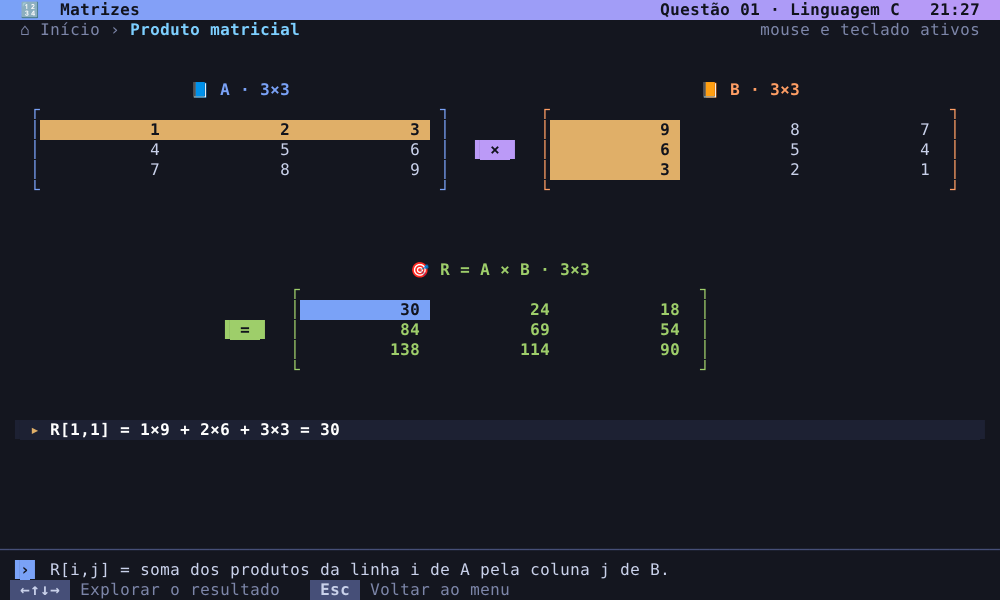
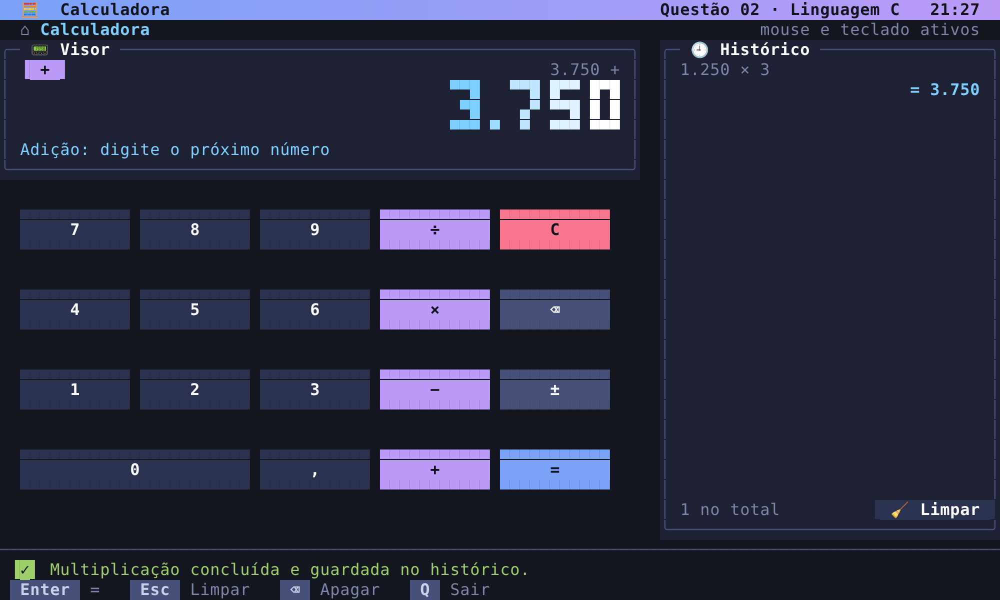
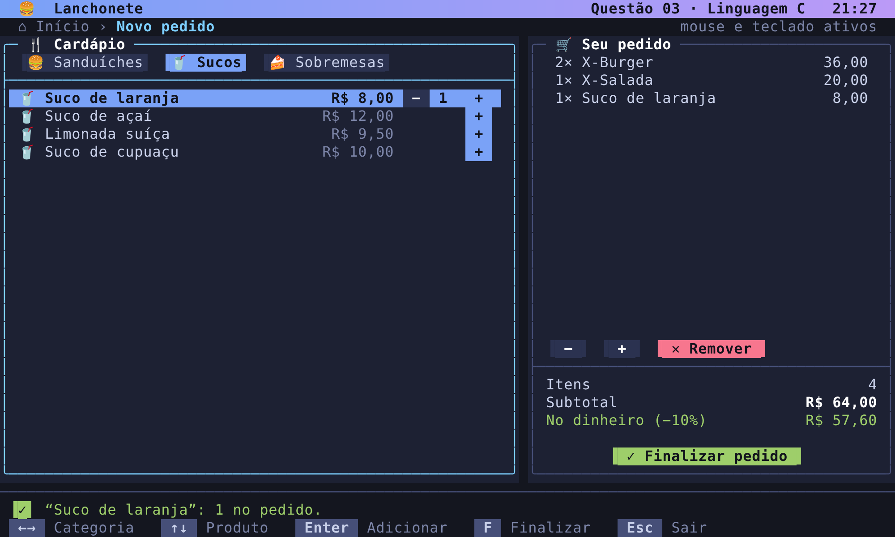
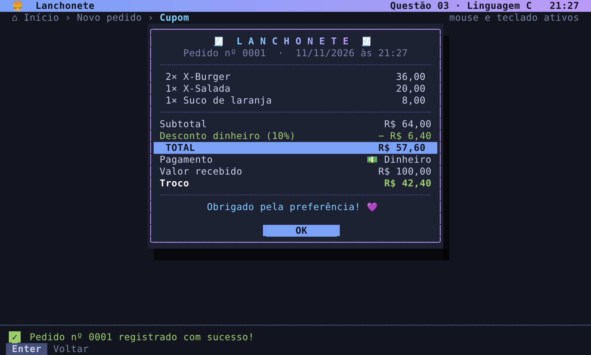

<div align="center">


**Três programas em C que parecem aplicativos de verdade, rodando direto no terminal do Windows.**

[🔢 Matrizes](#-questão-01--matrizes) ·
[🧮 Calculadora](#-questão-02--calculadora) ·
[🍔 Lanchonete](#-questão-03--lanchonete) ·
[🚀 Como executar](#-como-executar)

</div>

---

## ✨ Destaques

<table>
<tr>
<td width="50%" valign="top">

### 🎨 Visual
- Tema escuro com **cores de 24 bits** e degradês
- Painéis, sombras, botões em pílula e ícones coloridos
- Tela sem piscar (*double buffering*: só redesenha o que mudou)

</td>
<td width="50%" valign="top">

### 🖱️ Interação
- **Mouse completo**: clique, passagem (*hover*) e rolagem
- Teclado: setas, Enter, Esc, números e atalhos
- Botão direito do mouse volta para a tela anterior

</td>
</tr>
<tr>
<td width="50%" valign="top">

### 📐 Responsivo
- Ocupa a janela inteira (de 78×24 até 160×50)
- Redesenha na hora quando a janela muda de tamanho
- Avisa quando a janela é pequena demais

</td>
<td width="50%" valign="top">

### 🛡️ Robusto
- Validação de todas as entradas
- Confirmação antes de ações importantes
- Gravação segura em arquivo (temporário + troca)

</td>
</tr>
</table>

---

## 🔢 Questão 01 — Matrizes

> Leitura de duas matrizes **A** e **B** (até 5 × 5) com soma, multiplicação elemento a elemento e produto matricial.

<div align="center">

</div>

| Recurso | Como funciona |
|:--|:--|
| 📏 **Tamanho** | Clique direto na prévia 5×5 para escolher linhas e colunas |
| ✏️ **Editor em grade** | Clique numa célula e digite, como numa planilha |
| ➕ **Operações** | Soma `A + B`, elemento a elemento `A ∘ B` e produto `A × B` |
| 🔍 **Resultado explicado** | Clique numa célula de **R**: os valores usados ficam destacados e a conta aparece por extenso |
| 🎲 **Exemplo pronto** | Carrega matrizes 3×3 para testar na hora |

---

## 🧮 Questão 02 — Calculadora

> Calculadora com menu interativo, laço de repetição e `if/else if` para as quatro operações.

<div align="center">

</div>

| Recurso | Como funciona |
|:--|:--|
| ⌨️ **Teclado na tela** | Teclas clicáveis que clareiam ao passar o mouse e “afundam” ao clicar |
| 🔁 **Operações sucessivas** | `2 + 3 × 4 =` é calculado passo a passo |
| 🕘 **Histórico** | Clique num cálculo antigo para reutilizar o resultado |
| 🚫 **Erros tratados** | Divisão por zero, estouro de limite e teclas inválidas |
| 🔠 **Dígitos grandes** | Visor com números desenhados em blocos |

---

## 🍔 Questão 03 — Lanchonete

> Sistema de vendas com cadastro de produtos por categoria, carrinho, desconto e persistência em arquivo.

<div align="center">


</div>

| Recurso | Como funciona |
|:--|:--|
| 🍔🥤🍰 **Cardápio** | Sanduíches, sucos e sobremesas: cadastrar, editar e excluir |
| 🛒 **Carrinho** | Botões `−` e `+` em cada produto, subtotal em tempo real |
| 💵 **Pagamento** | Dinheiro (**10% de desconto** + troco), cartão ou Pix |
| 🧾 **Cupom** | Emitido ao confirmar e reaberto pelo histórico |
| 📊 **Painel** | Faturamento, ticket médio e gráfico dos últimos 7 dias |
| 💾 **Persistência** | `produtos.txt` e `pedidos.txt`, valores guardados em centavos |

---

## 🚀 Como executar

**Requisitos:** Windows 10 ou 11 · GCC/MinGW (ex.: [w64devkit](https://github.com/skeeto/w64devkit)) · de preferência o **Windows Terminal**

```powershell
# compilar
gcc questao01_matrizes.c    -o matrizes.exe
gcc questao02_calculadora.c -o questao02.exe
gcc questao03_lanchonete.c  -o questao03.exe

# executar (um por aba do terminal)
.\matrizes.exe
.\questao02.exe
.\questao03.exe
```

<details>
<summary>⚠️ <b>Problemas comuns</b></summary>
<br>

| Sintoma | Solução |
|:--|:--|
| `Permission denied` ao compilar | O programa ainda está aberto. Feche-o e compile de novo. |
| Mudanças no código não aparecem | Recompile: o `.exe` antigo continua igual até rodar o `gcc`. |
| Mouse não responde | Atualize o Windows Terminal. |
| Ícones viram quadradinhos | Use o Windows Terminal (o console antigo mostra símbolos simples). |
| “Janela pequena” | Aumente ou maximize a janela (mínimo 78 × 24). |

</details>

---

## 🗂️ Estrutura

```
📁 questionario-c
├── 📄 questao01_matrizes.c      # Questão 01
├── 📄 questao02_calculadora.c   # Questão 02
├── 📄 questao03_lanchonete.c    # Questão 03
├── 📁 docs/                     # capturas de tela do README
└── 📄 README.md
```

Cada arquivo é **independente** e traz no início o mesmo módulo de interface (cores, painéis, menus, mouse e diálogos), garantindo a mesma identidade visual nos três programas.

<div align="center">


Feito com 💜 em C · **UNIP · Ciência da Computação**

</div>
